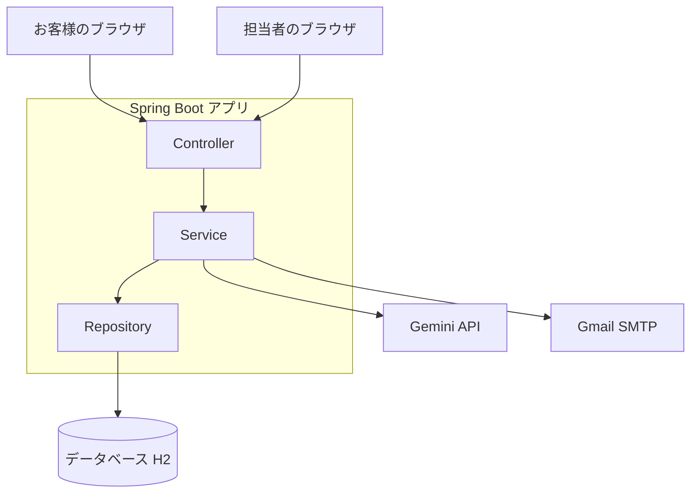

# 問い合わせ対応システム

お客様からの問い合わせを受け付け、担当者が管理・返信するためのWebアプリです。
**AIが返信文の下書きを作り、人間が確認してから、お客様のメールに送信する**流れを作りました。

<!-- スクリーンショットを docs/images/ に置いたら、下の行のコメントを外してください

-->

## 主な機能

**お客様向け(ログイン不要)**
- 問い合わせフォーム(入力チェック付き)と、受付完了ページ

**担当者向け(要ログイン)**
- 問い合わせの一覧・詳細表示
- ステータス管理(未対応 / 対応中 / 完了)
- **AIによる返信文の下書き生成**(Gemini API)
- 返信の保存と、**Gmail経由でのメール送信**(送信済みかどうかを履歴に記録)
- 問い合わせと対応履歴の削除
- フォームログイン(管理者アカウント)

## 使用技術

| 分類 | 内容 |
|---|---|
| 言語 | Java 17 |
| フレームワーク | Spring Boot 3.3(Spring MVC) |
| 画面 | Thymeleaf |
| DB | H2(ファイル保存)+ Spring Data JPA |
| 認証 | Spring Security(フォームログイン、CSRF対策) |
| メール | Spring Mail(Gmail SMTP) |
| AI | Gemini API(Java標準の HttpClient で呼び出し) |
| 入力チェック | Bean Validation |
| ビルド | Maven |

## 構成



設計の詳細(ER図、画面とURLの一覧)は [docs/design.md](docs/design.md) にあります。

## 工夫した点

- **AIは「提案」まで**:下書きは返信欄に入るだけで、人間が確認して、送信ボタンを押すまでは確定しません。メール送信前には確認ダイアログも出します
- **失敗しても書いた文章を失わない**:メール送信やAI呼び出しに失敗したときは、返信を保存せず、入力内容を画面に残します
- **AI APIの混雑に備えたリトライ**:429や503のとき、間隔を空けて最大3回まで自動でやり直します
- **秘密情報はコードに書かない**:APIキー、メールのパスワード、管理者のパスワードはすべて環境変数で渡します。管理者のパスワードが未設定なら、アプリは起動しません
- **お客様用と担当者用のURLを分離**:`/` と `/contact` は誰でも使え、`/admin` 以下はログイン必須です
- **入力の安全対策**:フォームの入力は専用のクラスで受けて検証し、メールの件名の改行は取り除いています(メールヘッダーの不正な書き換えの対策)。問い合わせ本文の中にAIへの指示のような文章があっても、従わないようにプロンプトで指定しています

## 今後の課題

- お客様向けフォームのスパム対策(CAPTCHA、送信回数の制限)
- 担当者を複数にする(ユーザー管理と権限)
- AIによるカテゴリの自動分類
- 検索・絞り込み機能
- テストコードの追加

## 必要なもの

- JDK 17 以上
- Maven 3.9 以上(IntelliJ IDEA / Eclipse / VS Code の Maven 機能でも可)

## 起動方法

```
mvn spring-boot:run
```

起動後、ブラウザで http://localhost:8080/ を開きます。

IDEから動かす場合は、`InquiryApplication` の `main` メソッドを実行してください。

## AI下書きを使うには

APIキーを環境変数 `GEMINI_API_KEY` に設定してから起動します。
キーはコードや properties に書かず、GitHub にも上げないでください。

- Windows (PowerShell): `$env:GEMINI_API_KEY="あなたのキー"`
- Windows (cmd): `set GEMINI_API_KEY=あなたのキー`
- macOS / Linux: `export GEMINI_API_KEY=あなたのキー`

キーが無くても、登録・一覧・詳細・ステータス変更・返信保存は動きます
(下書きボタンだけエラーメッセージが出ます)。
使うモデルは `application.properties` の `ai.model` で変更できます。

## 画面のURL

| URL | 対象 | 内容 |
|---|---|---|
| http://localhost:8080/ | お客様 | トップページ(問い合わせの案内) |
| http://localhost:8080/contact | お客様 | 問い合わせフォーム |
| http://localhost:8080/admin | 担当者(要ログイン) | 問い合わせ一覧(入口) |
| http://localhost:8080/admin/inquiries/{id} | 担当者(要ログイン) | 詳細・返信・削除 |

お客様にはトップページか問い合わせフォームのURLを伝えます。
動作確認では、お客様側は**シークレットウィンドウ**で開くと、ログイン状態と混ざらずに試せます。

## 起動スクリプト(Windows / PowerShell)

環境変数が5つあるので、毎回打たなくて済むように、ひな形 `start.example.ps1` を用意しています。

1. `start.example.ps1` を `start.ps1` という名前でコピーする
2. `start.ps1` を開いて、5つの値(管理者のユーザー名とパスワード、Gemini APIキー、Gmailアドレスとアプリパスワード)を書き換える
3. PowerShell でこのフォルダを開き、`.\start.ps1` を実行する

`start.ps1` はキーやパスワードを含むため、`.gitignore` でGitHubに上がらないようにしてあります。
ひな形のまま(未設定のまま)だと、チェックに引っかかって起動しません。

## ログイン(管理者)

担当者用の画面(一覧・詳細・返信・削除)はログインが必要です。
お客様向けのトップページ・問い合わせフォーム・受付完了ページは、ログイン不要で使えます。

**管理者のユーザー名とパスワードは環境変数で設定します。未設定だとアプリは起動しません。**

- PowerShell: `$env:ADMIN_USERNAME="好きなユーザー名"` と `$env:ADMIN_PASSWORD="長めのパスワード"`
- cmd: `set ADMIN_USERNAME=...` と `set ADMIN_PASSWORD=...`
- macOS / Linux: `export ADMIN_USERNAME=...` と `export ADMIN_PASSWORD=...`

パスワードは推測されにくい長いものにしてください(ほかのサービスと使い回さない)。
担当者は http://localhost:8080/admin を開くと、ログイン画面に移ります。

## 問い合わせの削除

詳細画面の一番下の「削除する」で、その問い合わせと対応履歴をまとめて削除できます(元に戻せません)。

## AI下書きのリトライ

AI APIが混雑している(HTTP 429 / 500 / 502 / 503 / 504)ときは、2秒・4秒と間隔を空けて、最大3回まで自動でやり直します。

## メール送信を使うには(Gmail)

詳細画面の「保存してメール送信」で、お客様のメールアドレス宛てに返信が届きます。
(「返信を保存(送信しない)」は、履歴に残すだけでメールは送りません)

1. Googleアカウントで **2段階認証** をオンにする
2. Googleアカウントの設定(セキュリティ → 2段階認証プロセス)から **アプリパスワード** を作る(16文字。空白は取り除いてOK)
3. 環境変数を設定してから起動する
   - PowerShell: `$env:MAIL_USERNAME="あなたのGmailアドレス"` と `$env:MAIL_PASSWORD="アプリパスワード"`
   - cmd: `set MAIL_USERNAME=...` と `set MAIL_PASSWORD=...`
   - macOS / Linux: `export MAIL_USERNAME=...` と `export MAIL_PASSWORD=...`

注意:
- 送信元は、ログインに使うGmailアドレスになります
- 最初のテストは、**自分のメールアドレスで問い合わせを登録して**、自分宛てに届くか確認してください
- アプリパスワードもAPIキーと同じ扱いです。コードに書かず、GitHubにも上げないでください
- 会社や学校のGoogle Workspaceアカウントは、管理者の設定でアプリパスワードが使えないことがあります
- メール送信に失敗したときは、返信は保存されず、入力した文章は画面に残ります

## データについて

H2 のファイルDBを使うため、データは `./data/` に保存され、再起動しても残ります。
セキュリティのため、H2コンソール(DBを直接見る画面)は無効にしています。

## フォルダ構成

```
src/main/java/com/example/inquiry/
  model/       Inquiry, Reply, InquiryStatus
  form/        InquiryForm(入力チェック付き)
  repository/  InquiryRepository
  service/     InquiryService, DraftService(AI呼び出し)
  controller/  InquiryController, HomeController
src/main/resources/
  templates/inquiries/  list.html, form.html, detail.html
  static/style.css
docs/design.md  設計メモ(構成・ER図・画面一覧)
```
