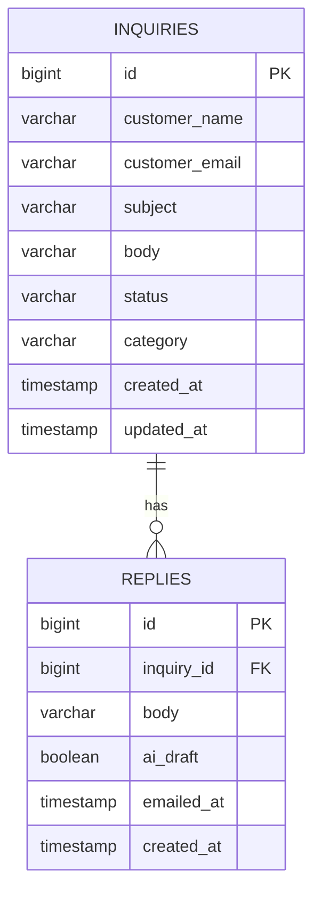

# 設計メモ

## 構成

ブラウザ → Controller → Service → Repository → データベース
                           ├→ AI API(返信の下書き生成: DraftService)
                           └→ Gmail(返信メール送信: MailService)

- Controller: 画面と入力の受け付け(お客様用 ContactController / 担当者用 InquiryController)
- Service: 業務ロジック(InquiryService)、AI呼び出し(DraftService)、メール送信(MailService)
- Repository: DB操作(Spring Data JPA)

## ER図

## 画面とURL

お客様向け(ログイン不要)

| URL | 内容 |
|---|---|
| GET / | トップページ |
| GET /contact | 問い合わせフォーム |
| POST /contact | 問い合わせの登録 |
| GET /contact/thanks | 受付完了ページ |

担当者向け(要ログイン)

| URL | 内容 |
|---|---|
| GET /login | ログイン画面 |
| POST /logout | ログアウト |
| GET /admin | 一覧への入口(未ログインならログイン画面へ) |
| GET /admin/inquiries | 問い合わせ一覧 |
| GET /admin/inquiries/{id} | 詳細・対応履歴・返信フォーム |
| POST /admin/inquiries/{id}/status | ステータス変更 |
| POST /admin/inquiries/{id}/draft | AIで返信を下書き生成 |
| POST /admin/inquiries/{id}/replies | 返信を保存(send=true のときはメールも送信) |
| POST /admin/inquiries/{id}/delete | 問い合わせと対応履歴の削除 |

## 認証

- Spring Security のフォームログイン。管理者は1人(環境変数 ADMIN_USERNAME / ADMIN_PASSWORD)
- ログイン不要: /、/contact、/contact/thanks、/login、/style.css
- それ以外はすべてログインが必要

## 今後の拡張案

- 担当者を複数にする(users テーブル、権限)
- お客様向けフォームのスパム対策(CAPTCHAや送信回数の制限)
- AIによるカテゴリ自動分類(category 列は用意済み)
- 検索・ステータス絞り込み
